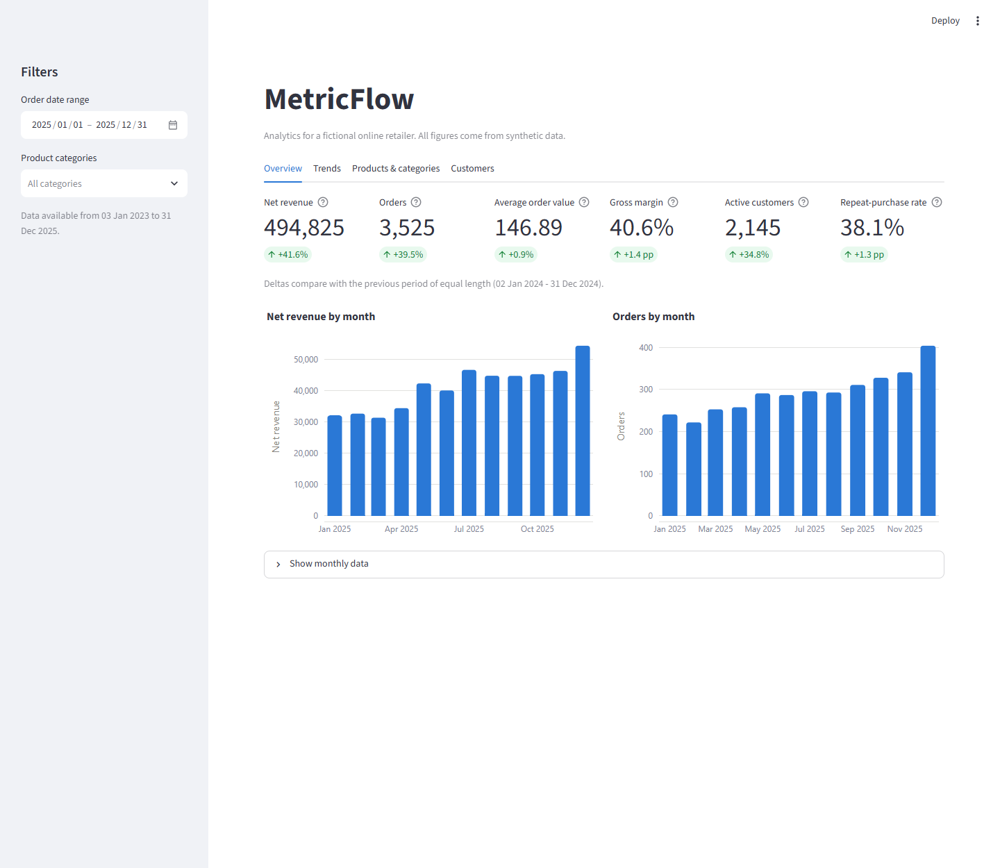
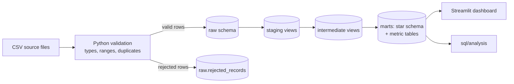
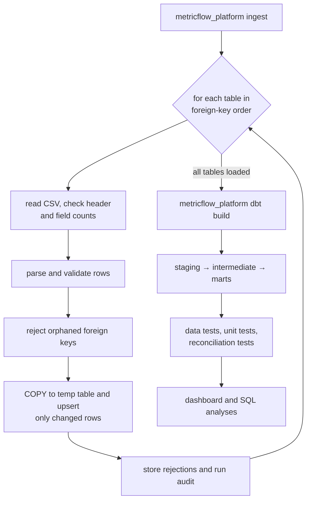
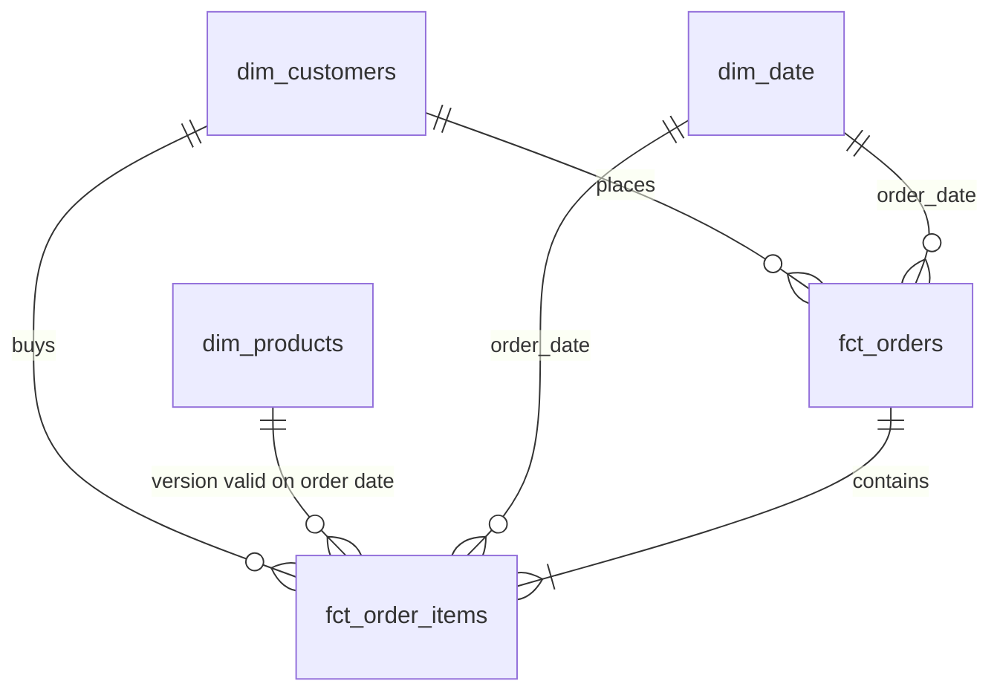
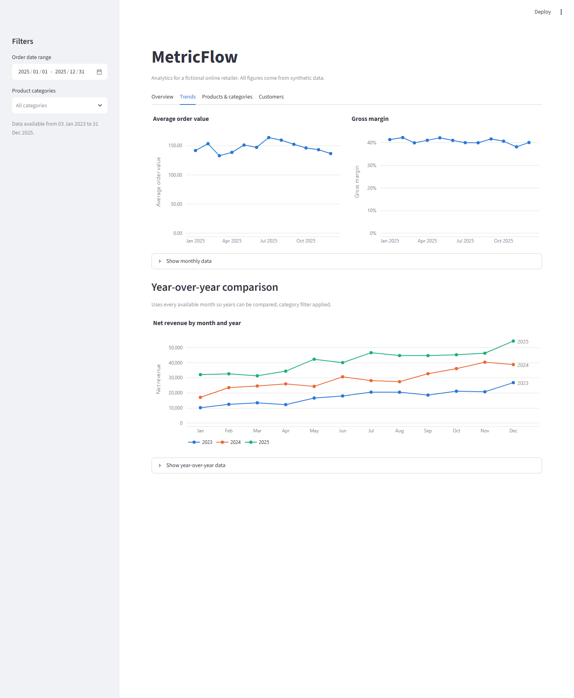
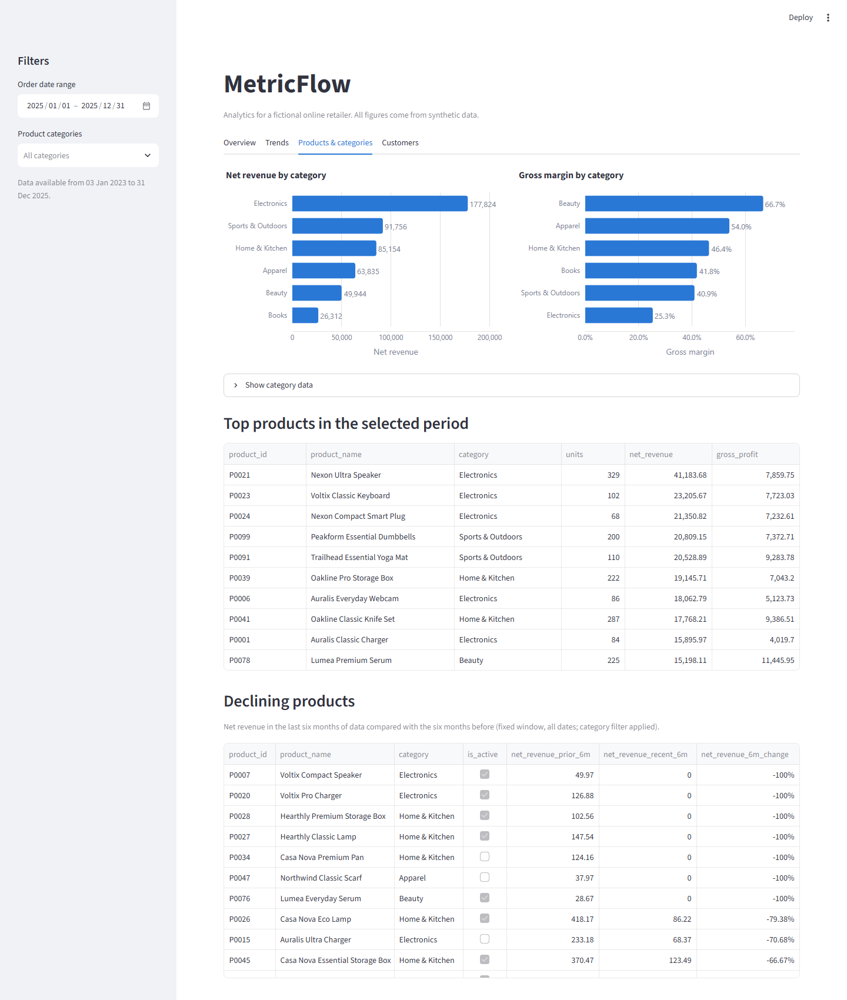
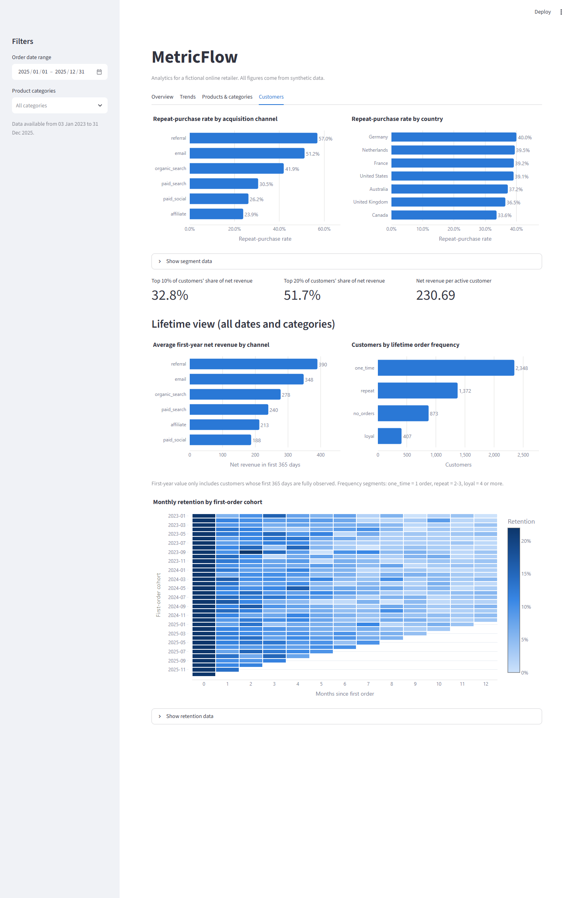

# MetricFlow

A production-style analytics engineering platform featuring dimensional modeling, dbt transformations, data quality testing, business metrics, and interactive BI dashboards.

MetricFlow takes raw order data from a fictional online retailer and turns it into trustworthy,
consistently defined business metrics:

```
raw CSV files → validated ingestion → PostgreSQL → dbt staging → intermediate → star schema → metric marts → Streamlit dashboard
```



## Contents

- [Goals and scope](#goals-and-scope)
- [Technology stack](#technology-stack)
- [Architecture](#architecture)
- [Dimensional model](#dimensional-model)
- [Data source and licensing](#data-source-and-licensing)
- [Repository structure](#repository-structure)
- [Getting started](#getting-started)
- [Configuration](#configuration)
- [Running the pipeline](#running-the-pipeline)
- [Testing and code quality](#testing-and-code-quality)
- [Business metrics](#business-metrics)
- [Example analyses](#example-analyses)
- [Dashboard](#dashboard)
- [Limitations and future improvements](#limitations-and-future-improvements)

## Goals and scope

- **Reliable ingestion**: validate schemas, types, required fields and ranges; reject malformed,
  duplicate and orphaned rows with a traceable reason; make reruns idempotent.
- **Layered dbt project**: staging, intermediate and marts layers with a documented star schema,
  including an SCD Type 2 product dimension.
- **One definition per metric**: revenue, margin, AOV, repeat purchasing, lifetime value and
  retention are defined once and reused by SQL and the dashboard.
- **Tested end to end**: pytest for Python logic and database integration, dbt data tests, dbt
  unit tests and reconciliation tests between layers.
- **Local first**: everything runs on free, open-source tools with no paid services or APIs.

Out of scope: real-time streaming, orchestration schedulers, forecasting and authentication.

## Technology stack

| Area | Tool | Version |
| --- | --- | --- |
| Language | Python | 3.12 |
| Warehouse | PostgreSQL | 15 (local development), `postgres:16` image in Docker Compose |
| Transformations | dbt Core + dbt-postgres | 1.12.6 / 1.11.0 |
| Data handling | pandas | 3.1.0 |
| Database driver | psycopg | 3.3.6 |
| Dashboard | Streamlit, Plotly | 1.66.1 / 7.1.0 |
| Testing | pytest, dbt tests | 9.1.1 |
| Code quality | Ruff, SQLFluff | 0.17.2 / 4.4.0 |
| Screenshots | Playwright (with a local Chrome) | 1.58.0 |
| Containers | Docker Compose | |

Pinned versions live in [`requirements.txt`](requirements.txt) and
[`requirements-dev.txt`](requirements-dev.txt). The Python package is named
`metricflow_platform` because dbt-core 1.12 depends on dbt Labs' unrelated `metricflow` package,
and the two would otherwise share an import name.

## Architecture



### Data flow



Design decisions (rejection policy, idempotent upserts, SCD2 derivation, UTC dates) are explained
in [docs/architecture.md](docs/architecture.md).

## Dimensional model



| Table | Grain |
| --- | --- |
| `fct_order_items` | One row per order line (additive revenue, cost and profit measures) |
| `fct_orders` | One row per order (line measures aggregated, customer order sequence) |
| `dim_customers` | One row per customer (SCD Type 1) |
| `dim_products` | One row per product price version (**SCD Type 2** on list price and unit cost) |
| `dim_date` | One row per calendar day |

Metric marts built on the star schema: `mart_monthly_kpis`, `mart_category_monthly`,
`mart_product_performance`, `mart_customer_metrics` and `mart_cohort_retention`.

Products are versioned so that historical gross profit uses the cost that was valid on the order
date. Tests assert that versions never overlap, that each product has exactly one current version
and that every order line references the version valid on its order date. Details:
[docs/data_model.md](docs/data_model.md) and [docs/data_dictionary.md](docs/data_dictionary.md).

## Data source and licensing

The dataset in [`data/sample`](data/sample) is **synthetic**, produced by a seeded generator in
this repository: 5,000 customers, 120 products with price history, about 7,800 orders, 15,000
order lines and 700 returns between 2023-01-01 and 2025-12-31. It describes no real company or
person and contains no personal information. A small set of deliberately defective rows exercises
the validation rules; they are listed in [data/sample/README.md](data/sample/README.md).

Code and data are released under the [MIT License](LICENSE).

## Repository structure

```
metricflow/
├── dashboard/app.py              Streamlit entry point
├── data/sample/                  Synthetic source CSVs and their documentation
├── dbt/
│   ├── macros/                   Schema naming, months_between
│   ├── models/
│   │   ├── staging/              One view per source table + sources
│   │   ├── intermediate/         SCD2 versions, enriched order lines, order sequence
│   │   └── marts/
│   │       ├── core/             Star schema: dims and facts
│   │       └── metrics/          KPI, category, product, customer and cohort marts
│   ├── tests/                    Singular tests and generic test definitions
│   ├── dbt_project.yml
│   └── profiles.yml              Environment-variable based, no credentials
├── docs/                         Architecture, data model, dictionary, metrics, insights, screenshots
├── scripts/capture_screenshots.py
├── sql/
│   ├── analysis/                 Business questions
│   └── investigations/           Data quality investigations
├── src/metricflow_platform/
│   ├── dashboard/                Queries, analysis, charts, formatting
│   ├── database/                 Connections and raw-layer DDL
│   ├── ingestion/                Loader and pipeline
│   ├── validation/               Table specs, parsers, CSV reader, validator
│   ├── cli.py                    Command-line interface
│   ├── config.py                 Environment-based settings
│   ├── logging_config.py
│   ├── metrics.py                Shared metric formulas
│   └── sample_data.py            Dataset generator
├── tests/                        Unit, dashboard and integration tests
├── docker-compose.yml
├── Dockerfile
├── Makefile
├── pyproject.toml
├── requirements.txt
└── requirements-dev.txt
```

## Getting started

### Option 1: Docker Compose

Requires Docker with Compose v2.

```bash
cp .env.example .env        # set METRICFLOW_DB_PASSWORD
docker compose up --build
```

Compose starts PostgreSQL, waits for its health check, runs ingestion and `dbt build` once, and
then serves the dashboard at <http://localhost:8501>. Stop with `docker compose down`; add
`--volumes` to delete the database.

### Option 2: Local Python environment

Requires Python 3.12+ and a PostgreSQL 15+ server you can create a database on.

```bash
python -m venv .venv
source .venv/bin/activate                  # Windows: .venv\Scripts\activate
pip install -r requirements-dev.txt
pip install --no-deps -e .
cp .env.example .env                       # point it at your PostgreSQL database
createdb metricflow                        # or create the database with any client

python -m metricflow_platform ingest       # validate and load the CSV files
python -m metricflow_platform dbt build    # build and test all models
streamlit run dashboard/app.py             # open http://localhost:8501
```

With `make` available, the same steps are `make install`, `make pipeline` and `make dashboard`
(`make help` lists every target).

## Configuration

Settings are read from environment variables; a `.env` file in the project root is loaded
automatically by the CLI, dbt wrapper and dashboard. Never commit `.env`.

| Variable | Default | Purpose |
| --- | --- | --- |
| `METRICFLOW_DB_HOST` | `localhost` | PostgreSQL host |
| `METRICFLOW_DB_PORT` | `5432` | PostgreSQL port |
| `METRICFLOW_DB_NAME` | required | Database name |
| `METRICFLOW_DB_USER` | required | Database user |
| `METRICFLOW_DB_PASSWORD` | empty | Database password (required by Docker Compose) |
| `METRICFLOW_RAW_SCHEMA` | `raw` | Schema that receives validated source data |
| `METRICFLOW_DATA_DIR` | `data/sample` | Folder with the source CSV files |
| `METRICFLOW_LOG_LEVEL` | `INFO` | `DEBUG`, `INFO`, `WARNING` or `ERROR` |

`dbt/profiles.yml` reads the same variables, so dbt needs no separate configuration.

## Running the pipeline

| Task | Command |
| --- | --- |
| Create the raw schema and metadata tables | `python -m metricflow_platform init-db` |
| Validate and load the source files (idempotent) | `python -m metricflow_platform ingest` |
| Load from another folder | `python -m metricflow_platform ingest --data-dir path/to/csvs` |
| Build and test all dbt models | `python -m metricflow_platform dbt build` |
| Any dbt command | `python -m metricflow_platform dbt <args>`, e.g. `dbt run --select marts` |
| Browse dbt documentation | `python -m metricflow_platform dbt docs generate` then `... dbt docs serve` |
| Regenerate the sample data | `python -m metricflow_platform generate-sample-data` |

Ingestion logs one key=value line per table with rows read, inserted, updated, unchanged,
rejected and de-duplicated. Rejected rows can be inspected with
[`sql/investigations/rejected_records_summary.sql`](sql/investigations/rejected_records_summary.sql).

## Testing and code quality

```bash
pytest                         # all tests; integration tests skip if PostgreSQL is unreachable
pytest -m "not integration"    # tests that need no database
python -m metricflow_platform dbt build    # dbt data tests and unit tests run with the models
ruff check . && ruff format --check .
sqlfluff lint dbt sql
```

What is covered:

| Layer | Tests |
| --- | --- |
| Parsing and validation | Valid and invalid integers, decimals, dates (including leap days), offset-aware timestamps, booleans; missing columns, malformed lines, BOMs, quoted commas; exact and conflicting duplicates; the shipped sample data yields exactly the documented rejections |
| Ingestion (PostgreSQL) | Idempotent reruns, in-place updates, appends, orphaned foreign keys, schema errors and missing files recorded as failed runs, rejection refresh |
| dbt data tests | Primary keys, not-null, accepted values, relationships, non-negative measures, value ranges, column ordering (cost <= price, discount <= gross) |
| dbt singular tests | SCD2 validity, returns never exceeding sold lines, order totals equal their lines, no rows or revenue lost between raw and marts, sales respecting signup, launch and discontinuation dates, monthly KPIs reconciling with facts, cohort month-0 retention |
| dbt unit tests | UTC order dates, SCD2 validity ranges, price-version lookup with returns, order sequencing |
| Metrics and dashboard | Metric formulas and edge cases, Python results equal to the dbt marts, analysis transformations, chart construction, Streamlit app rendering, filters and error states |

One dbt test, `assert_orders_have_lines`, is configured as a warning: in the sample data, order
`O000011` loses its only line to a conflicting duplicate key at ingestion. The order is excluded
from sales metrics and the warning keeps it visible.

## Business metrics

| Metric | Definition |
| --- | --- |
| Gross revenue | `quantity * unit_price` |
| Net sales | Gross revenue minus discounts |
| **Net revenue** | Net sales minus refunds |
| Gross profit / margin | Net revenue minus cost of units not returned; margin = gross profit / net revenue |
| Order count | Completed sales: non-cancelled orders with at least one valid line |
| Average order value | Net sales / order count |
| Repeat-purchase rate | Customers with 2+ orders / customers with 1+ orders in the same window |
| Customer lifetime value | Historical net revenue per customer (observed, not predicted) |
| Cohort retention | Share of a first-order cohort ordering again N months later |
| MoM / YoY growth | Change versus the previous month / same month of the previous year |

Formulas, assumptions (order-date attribution of refunds, restocked returns, no taxes or
shipping) and limitations are documented in [docs/metrics.md](docs/metrics.md).

## Example analyses

[`sql/analysis`](sql/analysis) answers business questions directly against the marts, for
example category performance:

```sql
select
    category,
    sum(net_revenue) as net_revenue,
    round(sum(net_revenue) / sum(sum(net_revenue)) over (), 4) as share_of_net_revenue,
    round(sum(gross_profit) / nullif(sum(net_revenue), 0), 4) as gross_margin
from marts.mart_category_monthly
group by category
order by net_revenue desc;
```

Other queries cover AOV over time, repeat purchasing by channel, declining products, revenue
concentration, cohort retention, discounts and refunds, and seasonality.
[docs/insights.md](docs/insights.md) lists the questions and the results computed from the sample
data, for example that Electronics brings in 39.4% of net revenue at a 25.0% gross margin, the
lowest of all categories. Because the data is simulated, these results describe the simulation,
not a real business.

## Dashboard

`streamlit run dashboard/app.py` opens a four-tab dashboard with date-range and category filters.
Every chart has a data table view, and empty selections, missing tables and connection problems
show explanatory messages.

| Overview | Trends |
| --- | --- |
|  |  |

| Products & categories | Customers |
| --- | --- |
|  |  |

- **Overview**: net revenue, orders, AOV, gross margin, active customers and repeat-purchase rate
  with deltas against the previous period of equal length; monthly revenue and orders.
- **Trends**: AOV and gross margin by month; year-over-year revenue by month.
- **Products & categories**: category revenue and margin, top products, declining products.
- **Customers**: repeat-purchase rate by channel and country, revenue concentration, first-year
  value by channel, order-frequency segments and a cohort retention heatmap.

Screenshots are captured from the running app with `python scripts/capture_screenshots.py`.

## Limitations and future improvements

- **Synthetic data.** Patterns such as channel differences and seasonality are generator
  parameters. Swapping in a real extract only requires CSVs that match the table specifications.
- **Snapshot-style ingestion.** Ingestion upserts rows but does not delete rows that disappear
  from a source file, and a row that becomes invalid keeps its last valid version in the raw
  layer. Soft-delete tracking would be needed for sources that remove records.
- **Docker stack not exercised during development.** Development and testing used a local
  PostgreSQL 15 server; the Compose configuration targets PostgreSQL 16 and has not yet been run
  end to end.
- **No orchestration or CI.** Commands are run manually or through Docker Compose. A scheduler
  (for example Dagster or Airflow) and automated checks on pull requests are natural next steps.
- **Historical CLV only.** Lifetime value is observed revenue; a predictive model (for example
  BG/NBD with Gamma-Gamma) would add forward-looking estimates.
- **Simple trend labels.** Product trend labels use fixed ±20% thresholds without volume
  minimums or seasonality adjustment (see [docs/insights.md](docs/insights.md#4-declining-products)).
- **Full rebuilds.** Mart tables are rebuilt on every run; incremental models would be needed for
  much larger volumes.
