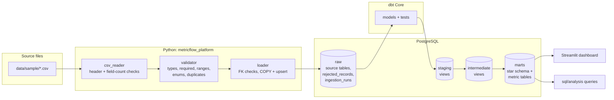
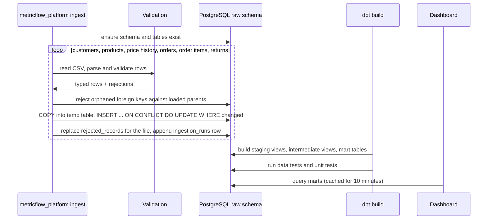

# Architecture

MetricFlow is a local-first analytics stack: Python validates and loads source files into
PostgreSQL, dbt transforms them into a star schema and metric tables, and a Streamlit dashboard
reads the marts. Every component is free, open source and runs on a laptop.



## Data flow



## Components

| Component | Location | Responsibility |
| --- | --- | --- |
| Configuration | `src/metricflow_platform/config.py` | Reads `METRICFLOW_*` environment variables (and `.env`), validates them, masks the password in logs |
| Sample data | `src/metricflow_platform/sample_data.py` | Deterministic generator for the synthetic dataset, including documented defects |
| Validation | `src/metricflow_platform/validation/` | Declarative table specs, strict parsers, CSV reader and validator |
| Database | `src/metricflow_platform/database/` | Connections with start-up retries; raw-layer DDL generated from the table specs |
| Ingestion | `src/metricflow_platform/ingestion/` | Per-table transactional loads, idempotent upserts, rejection storage, run audit |
| Transformations | `dbt/` | Staging, intermediate and mart models, generic and singular tests, unit tests |
| Metrics | `src/metricflow_platform/metrics.py` | Shared metric formulas for filtered dashboard views |
| Dashboard | `dashboard/app.py`, `src/metricflow_platform/dashboard/` | Streamlit UI; queries, pandas analysis, Plotly charts and formatting |
| Analyses | `sql/analysis`, `sql/investigations` | Business questions and data quality investigations |

## Design decisions

### Validate before loading, and keep what was rejected

Rows are validated in Python before they reach the database so that the raw layer only contains
typed, well-formed data. Rejected rows are not discarded silently: each one is stored in
`raw.rejected_records` with its source line number, reason, detail and original payload. The
table reflects the latest run of each file, and `raw.ingestion_runs` keeps the full history of
row counts per run.

Duplicate handling is deliberately conservative. Exact duplicates are collapsed. When the same
key arrives with different content, there is no reliable way to know which version is correct,
so every occurrence is rejected for investigation rather than picking one arbitrarily.

### Idempotent loads

Each table is loaded in a single transaction: rows are copied into a temporary table and merged
with `INSERT ... ON CONFLICT DO UPDATE ... WHERE (columns) IS DISTINCT FROM (new columns)`.
Re-running ingestion on unchanged files inserts and updates nothing, a changed row is updated in
place, and new rows are appended. Integration tests cover each of these cases.

Tables load in foreign-key order and the run stops at the first failing table, so child tables
are never validated against a parent that failed to load. Tables committed before the failure
stay committed and the failure is recorded in `ingestion_runs`.

### SCD Type 2 from source history instead of snapshots

Product prices and costs come with an effective date, so product versions are derived
deterministically in SQL. dbt snapshots would only record changes observed between pipeline
runs and could not reconstruct history from a single load. See [data_model.md](data_model.md).

### Stable schema names

A `generate_schema_name` macro makes dbt write to `staging`, `intermediate` and `marts` exactly,
so the dashboard and ad-hoc SQL do not depend on the target schema of whoever ran dbt.

### UTC reporting dates

Source timestamps must carry a UTC offset (naive timestamps are rejected). Reporting dates are
the UTC calendar date of the order, which keeps daily and monthly figures independent of the
database session time zone.

### One definition per metric

Additive measures are computed once at the order-line grain in dbt. Ratios are always computed
from summed numerators and denominators. The dashboard reuses `metricflow_platform.metrics`,
which applies the mart definitions to filtered rows, and an integration test checks that both
paths produce identical totals.

## Operational logging

The pipeline logs key=value lines such as:

```
2026-10-25T11:17:48 level=INFO logger=metricflow_platform.ingestion.pipeline table_loaded table=order_items rows_read=15380 inserted=0 updated=0 unchanged=15370 rejected=7 duplicates_removed=3
2026-10-25T11:17:48 level=WARNING logger=metricflow_platform.ingestion.pipeline rows_rejected table=order_items reasons={'conflicting_duplicate_key': 2, 'invalid_integer': 1, 'below_minimum': 1, 'malformed_row': 1, 'orphaned_foreign_key': 2}
```

`METRICFLOW_LOG_LEVEL` controls verbosity. Credentials are never logged.
