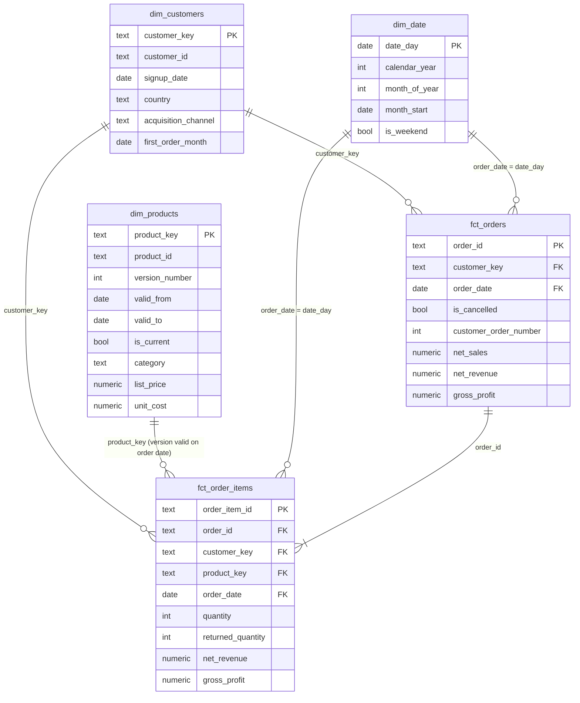

# Data model

MetricFlow models the business as a star schema in the `marts` schema. Two fact tables at
different grains share conformed customer, product and date dimensions.

## Fact tables

| Table | Grain | Notes |
| --- | --- | --- |
| `fct_order_items` | One row per order line | Lowest grain. Carries the product version valid on the order date, so cost and margin reflect the price list in force at the time. |
| `fct_orders` | One row per order | Line measures aggregated per order plus order attributes and the customer's order sequence number. |

Both fact tables keep cancelled orders and flag them with `is_cancelled`; every revenue metric
filters them out. All monetary measures are additive, so any
aggregate can be rebuilt from the line-level fact.

| Measure | Definition |
| --- | --- |
| `gross_revenue` | `quantity * unit_price` |
| `discount_amount` | Discount granted on the line |
| `net_sales` | `gross_revenue - discount_amount` |
| `refund_amount` | Sum of refunds issued for the line |
| `net_revenue` | `net_sales - refund_amount` |
| `cost_of_goods_sold` | `(quantity - returned_quantity) * unit_cost` of the valid product version |
| `gross_profit` | `net_revenue - cost_of_goods_sold` |

## Dimensions

| Table | Type | Grain | Notes |
| --- | --- | --- | --- |
| `dim_customers` | SCD Type 1 | One row per customer | Attributes are overwritten on reload. Includes the first order date, which defines the acquisition cohort. |
| `dim_products` | SCD Type 2 | One row per product price version | A new version starts whenever list price or unit cost changes. |
| `dim_date` | Static | One row per calendar day | Covers every day of each year that contains orders. |

### Why products are SCD Type 2

Unit cost changes roughly once a year. If the product dimension only held the latest cost,
historical gross profit would silently change every time a price list was updated. Versioning
the dimension and joining each order line to the version valid on its order date keeps
historical margins stable.

The source system provides price history with an effective date (`valid_from`), so versions are
derived deterministically in `int_product_versions` instead of with dbt snapshots, which would
only capture changes observed between pipeline runs:

- `valid_to` is the next version's `valid_from` and is **exclusive**; the current version has a
  null `valid_to` and `is_current = true`.
- `product_key` is `md5(product_id || '|' || valid_from)`, which is stable across rebuilds.

Validity is enforced by tests in [`dbt/tests`](../dbt/tests):

- versions of the same product never overlap;
- each product has exactly one current version, and it is the latest;
- each order line references the version valid on its order date;
- `product_key` is unique and every fact row resolves to a dimension row.

## Layers

| Layer | Schema | Materialisation | Purpose |
| --- | --- | --- | --- |
| Raw | `raw` | Tables (loaded by Python) | Validated source rows with lineage columns |
| Staging | `staging` | Views | Renaming, typing, light standardisation; one model per source table |
| Intermediate | `intermediate` | Views | Reusable logic: SCD2 versions, enriched order lines, customer order sequence |
| Marts | `marts` | Tables | Star schema and metric tables consumed by the dashboard |

Dates are reported in UTC: `order_date` is derived from the offset-aware order timestamp
converted to UTC, so results do not depend on the database session time zone.
